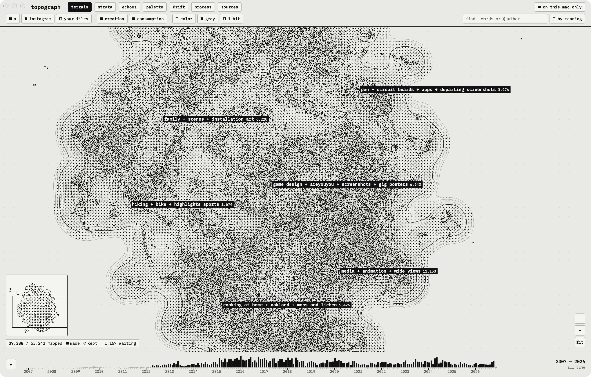
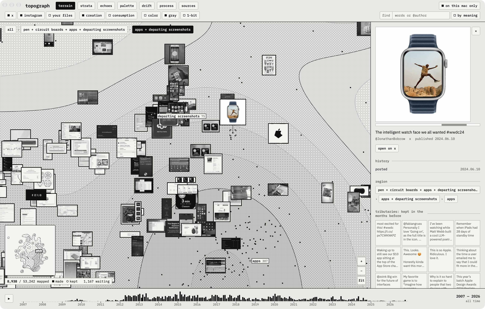
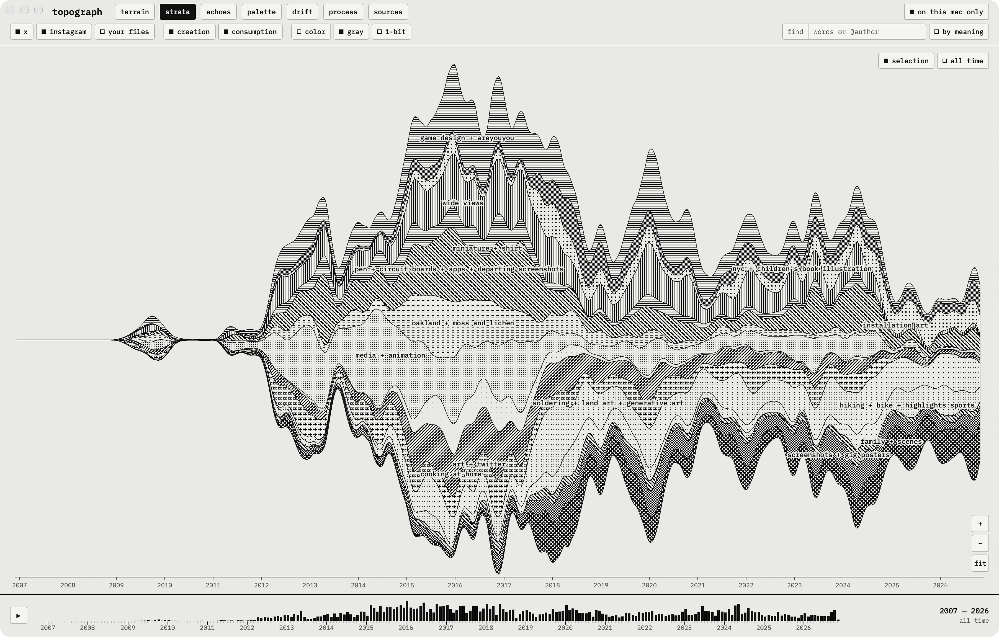
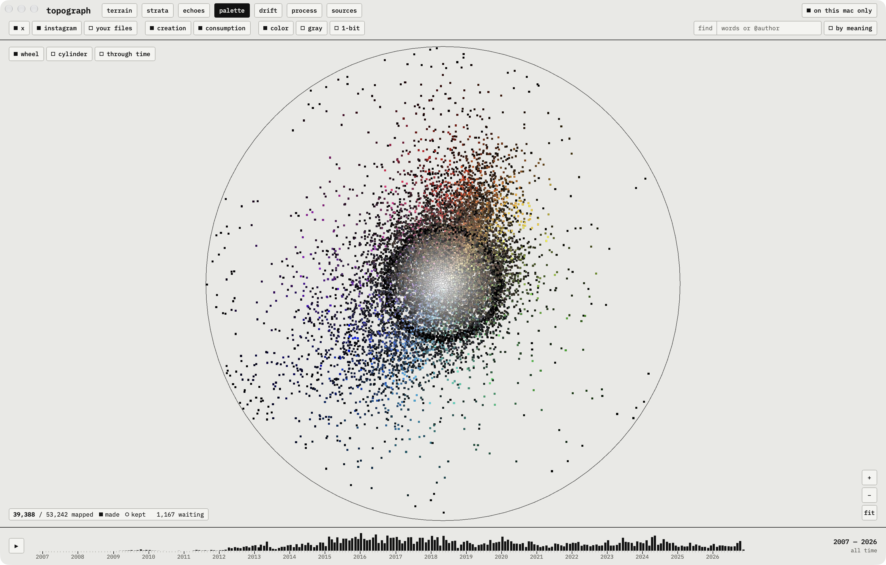
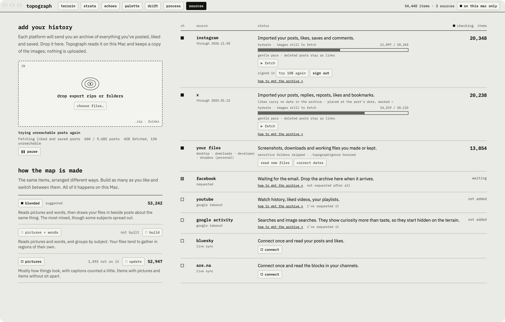

# Topograph

A private, on-device atlas of your taste.



Topograph reads the data exports from the platforms you use, along with the screenshots,
downloads and working files on your Mac. It keeps a local copy of what you posted, liked and
saved, and maps it as terrain: things you keep coming back to rise into mountain ranges,
passing interests stay foothills, and a timeline shows the landscape changing over the years.

There are no accounts and no telemetry, and your library stays on your Mac.

The screenshots here are from a real library of about 54,000 items.

## Status

Topograph is early, and so far it has one user. There are two ways to run it:

- **The Mac app** (`mac/`) has every view and runs the whole pipeline itself. It's where the
  work is happening.
- **The Python pipeline and web viewer** (`pipeline/`, `viewer/`) came first. They remain the
  reference for the native pipeline, and they can run without the Mac app.

Instagram, X and your own files have run on a real library. Facebook, YouTube, Google, Bluesky
and Are.na have only been tested on small sample data so far.

[docs/SPEC.md](docs/SPEC.md) has the full product spec and roadmap.

## The views

### Terrain

Everything you've engaged with, placed by visual and semantic similarity. Elevation is how much
it resonated, so a save outweighs a like. Zoom in and peaks resolve into images. Regions nest:
zoomed out you see the broad ones, and as you zoom in their names give way to the regions inside
them, with a bar at the top left showing where you are.

Things you made or posted are squares on the map, with solid frames on thumbnails. Things you
kept are circles. Click a picture to float it in color above its place and open its details: your
history with it, its region and its nearest neighbors in taste. For something you made, the panel
also lists **tributaries**, the things you kept in the months before it that sit closest to it.



Click a region's name to see what's in it and when it was on your mind, or to export it as a
moodboard. Images are gray by default, with **color** and **1-bit** modes, and they show in full
color on hover.

### Strata

Each region as a layer through time, drawn as a stream of dithered patterns. It answers "what was
I into in 2019?"



### Palette

Your taste with the subject matter stripped away. **Wheel** arranges everything by color and moves
like the terrain. **Cylinder** stands the same pictures up, with hue around it, colorfulness out
from its axis and light to dark from top to bottom. **Through time** is Strata's chart with bands
of color for layers.



### Process

Near-duplicates of your own work, grouped into pieces and played in order, so you can watch one
change from version to version.

### Echoes and Drift

**Echoes** finds themes that came back after a gap, shown as then and now with the months of
near-silence between them. **Drift** starts anywhere and shows an item with its nearest neighbors:
pick one and keep walking, with your trail along the side.

### Sources

Where your history comes in, with no terminal: drop in archives or folders, fetch images for liked
and saved posts, and sync Bluesky and Are.na. Nothing is added until you ask, and folders get a
first look before anything is read. It's also where you build maps and switch between them.



## Run the Mac app

It needs macOS 14 or later and Xcode.

```bash
git clone https://github.com/jbobrow/Topograph.git
cd Topograph
xcodebuild -downloadComponent MetalToolchain   # once, if Xcode doesn't have it yet
open mac/Topograph.xcodeproj                   # then press Run
```

### The models

The app needs CLIP (about 600 MB) to make any map or to search by meaning, and a text model (about
90 MB) for the blended and pictures + words maps. They're too large for the repository and aren't
bundled yet, so make them once from the same weights the pipeline uses. This is the one step that
still needs Python:

```bash
python3.13 -m venv /tmp/convert
/tmp/convert/bin/pip install coremltools open_clip_torch torch transformers
/tmp/convert/bin/python mac/tools/convert_clip.py
/tmp/convert/bin/python mac/tools/convert_minilm.py
```

They go in `~/Library/Application Support/Topograph/models/`.

### Build your map

1. Request your exports (below). They can take a day or two to arrive.
2. Open **Sources** and drop them in, along with any folders you want to read.
3. Fetch images for liked and saved posts. This is slow and polite, and you can stop and resume.
4. Build a map.

A map is one way of arranging your items, and a library can keep several:

- **Blended**, the suggested one, reads pictures and words and draws your files in beside posts
  about the same thing.
- **Pictures + words** reads the same things and groups by subject, so your files tend to gather in
  regions of their own.
- **Pictures** is mostly how things look, with captions counted a little.

### Finding your way around

- Drag to draw a rectangle to zoom into, and press esc to cancel it. Hold space and drag to move the
  map.
- Two fingers also move it and pinching zooms. With a mouse, the wheel zooms.
- While you're zoomed in, a minimap at the bottom left shows where you are. Press or drag on it to
  go somewhere else.
- Drag across the timeline to see a period, or press play to slide through the years. Space pauses
  it. The time you select applies to every view that has the timeline.
- In Strata, scrolling zooms around the pointer, and sideways scrolling or holding space and
  dragging moves along time. **Selection** fits the canvas to the time selected, and **all time**
  shows the whole timeline with that part shaded.
- **Find** matches words in captions and names. The **by meaning** key next to it finds what things
  are about, using CLIP on your Mac. Items only turn up once they have a vector, so anything just
  fetched waits until the map is next updated.
- Hold ⌘, or rest on a key for a second, to see its shortcut.
- **Map → Reload Library** (⌘R) shows a new layout. Pipeline commands can keep running while the
  app is open.

## Request your exports

| Platform | Where | Choose |
|---|---|---|
| Instagram | Accounts Center → Your information and permissions → Download your information | **JSON**, All time, High media quality |
| X | Settings → Your account → Download an archive of your data | (one format) |
| Facebook | Accounts Center → Your information and permissions → Download your information | **JSON**, All time, High media quality |
| YouTube and Google | [Google Takeout](https://takeout.google.com): deselect everything, then select YouTube and YouTube Music and My Activity | **JSON** rather than HTML, for both |

Bluesky and Are.na need no export. They read public data, with no login.

### What to expect from each

- **Your own posts** come with their images and captions, so they map immediately.
- **Liked and saved posts** arrive as links only, so their images have to be fetched. For X that
  uses the public endpoint behind embedded tweets. For Instagram it tries each post's public embed
  page. Instagram refuses many of those, so Sources offers to sign in, in a web view whose login
  page is Instagram's own. Some posts will stay unreachable, and they still count in Strata as "not
  yet mapped".
- **X likes** carry no date in the archive. Topograph uses the post's own date as an estimate and
  marks it as approximate.
- **Google searches** show curiosity more than taste, so they start hidden on the terrain.

## Your files

Topograph reads folders on your Mac in place, stores previews rather than copies, and keeps only
what macOS says is yours: screenshots, downloads (with the address they came from), files you've
opened, and working files like PSD, Sketch, Procreate, STL and video. It skips icons, assets inside
code projects, saved web pages, files that are only in the cloud, PDFs, and anything in folders
named like medical, ID, tax or banking.

Your own photos are dated by when they were taken, not when they reached your Mac.

Always take the first look before reading a folder. It ends with a list of folders full of images
that show no sign of being yours. Leave out the ones that aren't your work, or put a
`.topographignore` file in a folder above them. It works like .gitignore: one path or pattern per
line, relative to that folder, and `!` keeps one back:

```
# a mirrored class site: leave out everyone's page but mine
863.14/people/*/
!863.14/people/jonathan_bobrow/
```

## Privacy

- Nothing leaves your Mac except requests to fetch content you already engaged with, at a human
  pace, plus one-time downloads of model weights.
- There's no telemetry and no account.
- Instagram DMs are never read.
- Naming regions with Claude is off until you turn it on with your own API key, and it says what
  it sends first.

The library lives in `~/Library/Application Support/Topograph/` (override with the
`TOPOGRAPH_LIBRARY` environment variable). It's one SQLite file plus a `media/` folder of optimized
copies.

## The Python pipeline and web viewer

This does the same work from a terminal and writes `topograph.json` for a web viewer on
`localhost`, which has Terrain and Strata. It requires Python 3.10+, and on Apple silicon CLIP runs
on the GPU via Metal. `ffmpeg` is optional (`brew install ffmpeg`); with it, videos get a poster
frame.

```sh
python3 -m venv .venv && source .venv/bin/activate
pip install -e ".[clip,words,heif]"
```

```sh
topograph import ~/Downloads/instagram-yourname-2026-11-06-*.zip   # all parts at once
topograph import ~/Downloads/twitter-2026-11-06-*.zip
topograph import ~/Downloads/facebook-yourname-*.zip
topograph import ~/Downloads/takeout-*.zip        # YouTube and Google searches
topograph files ~/Desktop ~/Downloads --dry-run   # see what it would take from your folders
topograph files ~/Desktop ~/Downloads             # then read them
topograph sync bluesky your.handle                # or: sync arena your-username
topograph hydrate          # fetch images for liked/saved posts (slow and polite; resumable)
topograph build            # embeddings + layout + region names (a new library gets the blended map)
topograph build --map words  # build another map: blended, words or pictures
topograph regions          # print the region tree and names
topograph serve            # opens http://127.0.0.1:8732
```

- `topograph stats` summarizes the library at any time. Re-importing a newer export only adds
  what's new.
- `--map words` is the map the app calls pictures + words. Blended and words download the text
  model once (about 90 MB, from Hugging Face), and nothing of yours is sent. Other commands act on
  the map built last.
- `--library PATH` picks another library.
- `topograph files` with no folders picks up what's new. `--exclude ~/path/to/folder` leaves one out
  and is remembered for next time. `--fix-dates` corrects the dates of files imported earlier and
  adds nothing.

## Development

```sh
pip install -e ".[dev]"
python -m pytest -q tests                     # the lite embedder, so no model download
swift test --package-path mac/TopographCore   # the Mac app's core
```

The Python tests build small exports in both Instagram record formats (including its mis-encoded
emoji) and an X archive with split files, then run the whole pipeline.

```
mac/
  TopographCore/  Swift package with no UI: the library, map data and native pipeline
  Topograph/      SwiftUI shell and Metal canvas
  tools/          the app icon, model conversion, and comparing a library against Python's
pipeline/topograph/
  importers/      platform export parsers, plus your own folders read in place
  db.py           library schema
  media.py        display copies, thumbnails, palettes, perceptual hashes
  sync.py         Bluesky and Are.na
  hydrate.py      fetch media for links
  embed.py        CLIP (or lite) embeddings, and the text model
  maps.py         the recipe for each map
  layout.py       UMAP map, HDBSCAN regions
  regions.py      nesting regions and naming them
  concepts.txt    vocabulary for region names (edit freely)
  export.py       viewer data + local server
viewer/           static web viewer (d3 and IBM Plex fonts, bundled; Plex is under the SIL OFL)
docs/SPEC.md      product spec
```
